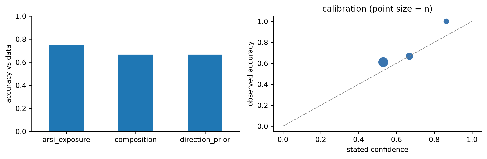

# ARSI resistance in Prostate cancer: candidate discovery and an LLM reasoning check

Shu Chen, Postdoctoral Scholar, UCSF 

I study why prostate cancer stops responding to androgen receptor signaling inhibitors (ARSIs) such as enzalutamide. In the lab I found that **SSTR1** (somatostatin receptor 1) is downregulated in ARSI-resistant prostate cancer post ARSI treatment, and I am working on SSTR1 as an actionable therapeutic target ([AACR abstract B010, *Cancer Res* 2026](https://scholar.google.com/citations?hl=en&user=WkITc2YAAAAJ)). This repository checks that finding against public patient data, and then uses the same data to test where a language model's biological reasoning holds up and where it fails.


*Left: CRPC vs localized prostate cancer. Gold points are significant genes whose signal tracks stroma, immune or mast cells, or surgical tissue handling rather than tumor cells. Right: among the 25 most significant genes, 80% are this kind of artifact.*

## Question

1. Which genes change as prostate cancer becomes castration-resistant, and which of those changes come from the tumor cells rather than from how the samples were collected?
2. Which of them hold up in an independent cohort that compares ARSI-exposed with ARSI-naive metastatic tumors? Does SSTR1?
3. When Claude is asked the same questions without seeing the data, how often does it agree with the data, and are its mistakes the kind an expert would catch?

## Data

| Cohort | Role | Samples | Access |
|---|---|---|---|
| GSE35988 (Grasso et al., *Nature* 2012) | discovery | 49 localized (prostatectomy), 27 metastatic CRPC (rapid autopsy), 12 benign; Agilent arrays | NCBI GEO |
| SU2C/PCF 2019 (Abida et al., *PNAS* 2019) | replication | 257 mCRPC patients (136 ARSI-exposed, 121 ARSI-naive); RNA-seq | cBioPortal API |
| UniProt | annotation | subcellular location and protein class for tested genes | REST API |

Raw data are not committed; the notebook downloads and caches them. Details in [data/README.md](data/README.md).

## Analysis

All in [notebooks/prostate_cancer_analysis.ipynb](notebooks/prostate_cancer_analysis.ipynb), about 5 minutes end to end. Thresholds are set in the first code cell, before any gene list is inspected.

1. **Differential expression**, CRPC vs localized: Welch's t-test on log2 ratios, Benjamini-Hochberg FDR. Hit = FDR < 0.05 and |log2FC| > 1.
2. **Composition and handling check.** Localized tumors are surgical specimens that contain benign stroma and immune cells; CRPC samples are metastases taken at autopsy. I score each sample for smooth-muscle stroma, immune cells, mast cells and immediate-early stress genes (FOS, EGR1 and others, induced by surgical ischemia). A hit is flagged if it correlates with any score (Spearman rho ≥ 0.5) across localized tumors.
3. **Pathways** (MSigDB Hallmark via Enrichr) on the hits that survive step 2.
4. **Replication in SU2C**: top 300 surviving hits plus SSTR1 (pre-specified), model `expression ~ ARSI exposure + biopsy site`, one biopsy per patient. AR is the positive control.
5. **UniProt annotation**: cell-surface location and protein class (GPCR, kinase, enzyme, etc.).
6. **Candidate table**: rule-based tiers, written to [results/candidate_targets.csv](results/candidate_targets.csv).

## AI Component

My work at the bench is deciding which computational leads deserve an experiment. If a model is going to help with that, I need to know when its intuition can be trusted. I turned the results above into 35 questions where the answer comes from the data, not from my opinion ([evaluation/tasks.csv](evaluation/tasks.csv)), which are sent to Claude through the API ([evaluation/run_claude.py](evaluation/run_claude.py)). The model sees the cohort description and the gene, never the results.

| Task type | n | What the model is asked | Ground truth |
|---|---|---|---|
| `direction_prior` | 12 | Is this gene higher, lower, or unchanged in CRPC vs localized? | GSE35988 result |
| `composition` | 12 | Given the effect size, is this a tumor-cell change or a composition/handling artifact? | flag from analysis step 2 |
| `arsi_exposure` | 8 | Is this gene higher, lower, or unchanged after ARSI exposure? | SU2C site-adjusted result |
| `open` | 3 | Explain an artifact, name SSTR1-engaging drugs, design the first causal experiment | my 0-2 score against a written rubric |

Each answer comes with a stated confidence, so the evaluation measures calibration as well as accuracy. Answers are structured JSON. The model that actually answered is logged in case a server-side fallback is triggered.

## Evaluation

Scored in the last section of the notebook; per-question results are in [evaluation/scoring.csv](evaluation/scoring.csv).
- **Closed questions:** exact match against the data-derived label. Reported as accuracy per task type, plus the Brier score for confidence.
- **Open questions:** scored 0-2 by me against the rubric in `tasks.csv`. The rubric was written before I saw any model answers.
- **Failure cases:** wrong answers given with confidence ≥ 0.7 are listed separately. For each one I note whether the model was wrong or whether the dataset is unusual (for example, FOLH1/PSMA is lower in CRPC in this array dataset, which contradicts most of the literature).

### Results: Claude Opus 5.5 (`claude-opus-5-5`, effort high, one run, October 2026)

| Task type | n | Accuracy vs data | Mean stated confidence | Brier |
|---|---|---|---|---|
| `direction_prior` | 12 | 0.67 | 0.66 | 0.18 |
| `composition` | 12 | 0.67 | 0.65 | 0.20 |
| `arsi_exposure` | 8 | 0.75 | 0.53 | 0.20 |
| **all closed** | 32 | **0.69** (22/32) | 0.62 | 0.19 |
| `open` (expert, 0-2) | 3 | mean 2.0 | | |



What the errors look like:

- **It uses effect size as evidence of artifact.** It caught all 6 composition/handling artifacts but called 4 of 6 tumor-intrinsic genes artifacts too (UNC5D, CHP2, ATP8B4, CD38), mainly because the fold change was large. A model helping triage hits would discard real candidates this way.
- **It rarely predicts "no difference."** Across the 20 three-option questions it answered `no_significant_difference` twice; the data say 6. SSTR2, SST, EZH2 (after ARSI) and GHR were all predicted to change and did not.
- **Confidence is usable.** All 5 answers given with confidence above 0.8 were correct. The only high-confidence error was FOLH1/PSMA (0.70), where I judge the dataset, not the model, to be unusual. For CD38 I think the model's argument (benign luminal epithelium, which my scores do not model) is defensible, so that label is disputed rather than a clear model error.
- **Open questions were strong.** It identified the surgical-ischemia artifact behind FOS/FOSB/EGR1 and proposed the same check I used. It got SSTR1 pharmacology right (pasireotide yes, octreotide/lanreotide negligible, no selective agonist approved). It designed a sound isogenic experiment, though it left out a ligand arm: SSTR1 signaling needs somatostatin or an analog, which culture media may not supply.
- **Over-refusal.** 3 of 35 benign questions (DPP4 after ARSI, SSTR1 drugs, the SSTR1 experiment) were declined by the safety classifier and answered by the fallback model, Claude Opus 5. For a working biologist, these are false positives worth reporting.

My adjudication of every error is in the `expert_note` column of `scoring.csv`.

## Findings

- **Most top hits are not tumor biology.** 1,282 of 5,746 hits (34% of downregulated, 3% of upregulated) track stroma, immune, mast-cell or handling signals, including 20 of the top 25. Ranking candidates by p-value alone would have sent me to the bench with PAGE4, ACTG2 and mast-cell genes.
- **After filtering, the biology is coherent.** Retained upregulated hits are enriched for E2F targets and G2-M checkpoint; downregulated hits for Androgen Response. AR, EZH2 and AURKA rise in CRPC as expected.
- **Six candidates replicate in ARSI-exposed tumors** (FDR < 0.10): DPP4, ST6GALNAC1, TRPM8, SNTG2, TSPAN11, AGBL2, all lower after ARSI exposure. TRPM8 and DPP4 are androgen-regulated, so the most reproducible signal is loss of AR output under ARSI pressure. The AR positive control behaves as expected (higher after ARSI, p = 3e-5).
- **SSTR1 is consistent with my bench result but not conclusive on public data alone.** Lower in CRPC (log2FC -1.18, FDR 0.047), not driven by composition (rho 0.01). Lower in ARSI-exposed mCRPC (unadjusted p = 0.013; site-adjusted beta -0.34, p = 0.077), with the effect concentrated in lymph node and bone biopsies. SSTR1 correlates with AR activity (rho 0.19, p = 0.002), consistent with it sitting downstream of AR signaling.

- **Claude agrees with the data 69% of the time without seeing it,** and its stated confidence tracks its accuracy. Its main bias is to read large effects as artifacts and to predict changes where there are none. Both matter for hit triage, and both would be caught by checking against the data, as done here.


## Limitations

- Association, not causation; that is what the bench experiments are for.
- CRPC vs localized mixes castration, metastasis, chemotherapy and autopsy vs surgical collection. The composition flag removes the obvious artifacts, not all of them. Marker-based scores are not a full deconvolution.
- Welch's t-test is simple and transparent; limma would be the formal choice and could move borderline genes such as SSTR1.
- In SU2C, ARSI exposure is not the same as ARSI resistance, and low-expressed genes have limited power in FPKM data.
- mRNA is not protein. For SSTR1, the quantity that matters for a ligand-based therapy is surface receptor protein.
- The evaluation is small (35 questions, one run of one model), and 3 answers came from the fallback model. It is meant to find failure modes, not to produce a benchmark score.

## Reproduce

```bash
git clone https://github.com/Shu-Chenzy/prostate-ai-hypothesis-evaluation.git
cd prostate-ai-hypothesis-evaluation
pip install -r requirements.txt
jupyter nbconvert --to notebook --execute --inplace notebooks/prostate_cancer_analysis.ipynb
python evaluation/run_claude.py          # needs ANTHROPIC_API_KEY; then re-run the notebook to score
```

## Repository layout

```
├── README.md
├── data/README.md                    data sources; downloads are cached here, not committed
├── notebooks/prostate_cancer_analysis.ipynb
├── results/
│   ├── candidate_targets.csv         tested candidates with tiers, SU2C statistics, UniProt class
│   ├── deg_crpc_vs_localized.csv     all 17,237 genes with composition correlations
│   └── figures/
├── evaluation/
│   ├── tasks.csv                     35 questions with data-derived answers
│   ├── run_claude.py                 sends tasks to the Claude API
│   ├── responses_<model>.csv         raw model answers (written by run_claude.py)
│   └── scoring.csv                   per-question scores (written by the notebook)
└── requirements.txt
```

## Contact

Shu Chen · shu.chen@ucsf.edu · [LinkedIn](https://www.linkedin.com/in/shu-chen-170111323/) · [Google Scholar](https://scholar.google.com/citations?hl=en&user=WkITc2YAAAAJ)
