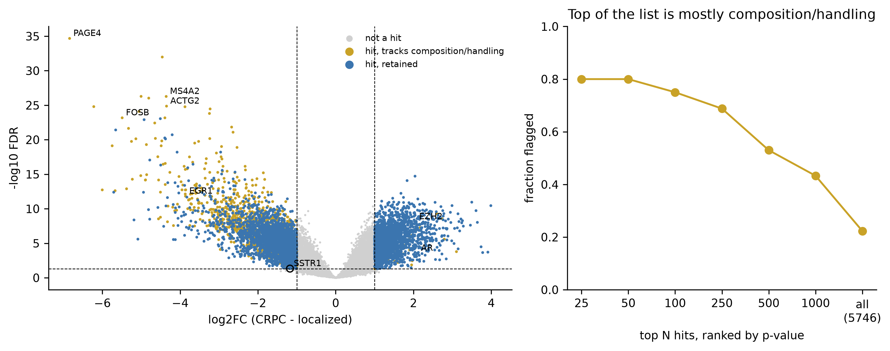
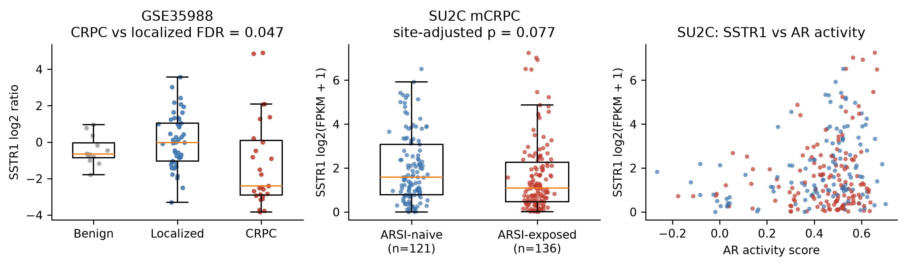

# Public-data analysis of ARSI resistance in prostate cancer

**Shu Chen — Postdoctoral Scholar, UCSF**

This repository uses public patient data to examine expression changes associated with advanced, treatment-exposed prostate cancer and to prioritize signals for experimental follow-up. SSTR1 is included as a prespecified gene because it is a focus of my current UCSF work.

A secondary analysis asks a narrower question: when a language model is asked to reason about these results without seeing the answers, where does it agree with the data and where does it fail?



*CRPC vs localized prostate cancer. Gold points are significant genes flagged for association with stromal, immune, mast-cell, or tissue-handling signatures. Twenty of the 25 most significant genes are flagged by this check.*

## Questions

1. Which genes differ between localized prostate cancer and metastatic CRPC?
2. Which leading signals are likely confounded by specimen composition or tissue handling?
3. Which candidates show a concordant signal in an independent mCRPC cohort stratified by prior ARSI exposure?
4. Do public data support the direction of the SSTR1 signal observed in my experimental work?

## Data

| Cohort | Use | Samples | Source |
|---|---|---|---|
| GSE35988 (Grasso et al., *Nature* 2012) | discovery | 49 localized, 27 metastatic CRPC, 12 benign; Agilent array | NCBI GEO |
| SU2C/PCF 2019 (Abida et al., *PNAS* 2019) | replication | 257 mCRPC patients: 136 ARSI-exposed, 121 ARSI-naive | cBioPortal |
| UniProt | annotation | subcellular location and protein class | REST API |

The notebook downloads public data on first run and caches them locally. See [`data/README.md`](data/README.md).

## Analysis

The full workflow is in [`notebooks/prostate_cancer_analysis.ipynb`](notebooks/prostate_cancer_analysis.ipynb).

1. **Differential expression:** CRPC vs localized prostate cancer using Welch's t-test on log2 array ratios with Benjamini-Hochberg correction. Discovery threshold: FDR < 0.05 and |log2FC| > 1.
2. **Composition/handling check:** genes are flagged if their expression tracks smooth-muscle stroma, immune, mast-cell, or immediate-early stress scores across localized tumors (Spearman |rho| >= 0.5).
3. **Pathway analysis:** MSigDB Hallmark enrichment on unflagged up- and down-regulated hits.
4. **Independent cohort:** the top 300 unflagged candidates plus prespecified SSTR1 are tested in SU2C/PCF using `expression ~ ARSI exposure + biopsy site`, one biopsy per patient. AR is used as a positive control.
5. **Annotation:** UniProt location and protein class are added for candidate review.
6. **Prioritization:** candidates are grouped by whether the discovery signal is unflagged and whether it replicates in the SU2C analysis. This is a triage step, not evidence of causality or druggability.

## Main results

- **Specimen composition is a major confounder in the discovery contrast.** Of 5,746 discovery hits, 1,282 are flagged by the marker-score check; 20 of the top 25 hits are flagged. Many of the strongest down-regulated signals are stromal, mast-cell, or immediate-early genes.
- **The retained expression program is biologically coherent.** Up-regulated genes are enriched for E2F targets and G2-M checkpoint; down-regulated genes are enriched for Androgen Response. AR, EZH2, and AURKA increase in CRPC.
- **Six candidates show a concordant ARSI-exposure signal in SU2C at FDR < 0.10:** DPP4, ST6GALNAC1, TRPM8, SNTG2, TSPAN11, and AGBL2, all lower after ARSI exposure.
- **SSTR1 is directionally consistent with my experimental work but does not meet the replication threshold after site adjustment.** It is lower in CRPC (log2FC -1.18, FDR 0.047) and lower in ARSI-exposed mCRPC (site-adjusted beta -0.34, p = 0.077). Its expression does not track the four composition/handling scores used here (max |rho| = 0.01).



The candidate-level results are in [`results/candidate_targets.csv`](results/candidate_targets.csv); full gene-level statistics are in [`results/deg_crpc_vs_localized.csv`](results/deg_crpc_vs_localized.csv).

## LLM reasoning check

I converted data-derived results from the analysis into 35 questions and sent them to Claude through the API. The model receives the cohort description and task-specific inputs, but not the answer label.

| Task type | n | Reference answer |
|---|---:|---|
| CRPC direction | 12 | GSE35988 differential-expression result |
| Composition/handling | 12 | marker-score flag from the analysis |
| ARSI exposure | 8 | SU2C site-adjusted result |
| Open questions | 3 | prespecified 0–2 expert rubric |

Closed questions are scored by exact match; open questions are scored manually against the rubric written in [`evaluation/tasks.csv`](evaluation/tasks.csv). Confidence is recorded for calibration analysis.

For the requested Claude Opus 5.5 run, 22/32 closed answers matched the data-derived label (69%). The main errors were over-calling large expression changes as composition effects and predicting a change when the data showed no significant difference. Three prompts were served by a fallback model after refusals and are identified in [`evaluation/scoring.csv`](evaluation/scoring.csv).

This is an exploratory check, not a benchmark. A separate repository contains the smaller, blinded multi-model evaluation: [claude-scientific-eval](https://github.com/Shu-Chenzy/claude-scientific-eval).

## Limitations

- These analyses are associative. Causality requires perturbation experiments.
- The discovery comparison mixes disease stage, metastatic site, prior therapy, and autopsy vs surgical collection. The marker-score filter addresses only part of that confounding.
- Marker averages are not a full cell-type deconvolution.
- Welch's t-test is intentionally simple; limma would be preferable for a formal microarray analysis and may move borderline genes.
- ARSI exposure in SU2C is not equivalent to ARSI resistance, and low-expression genes have limited power in FPKM data.
- mRNA does not establish surface protein abundance or receptor function.

## Reproduce

```bash
git clone https://github.com/Shu-Chenzy/prostate-ai-hypothesis-evaluation.git
cd prostate-ai-hypothesis-evaluation
pip install -r requirements.txt
jupyter nbconvert --to notebook --execute --inplace notebooks/prostate_cancer_analysis.ipynb
python evaluation/run_claude.py   # requires ANTHROPIC_API_KEY
```

Re-run the notebook after the API step to rebuild the scoring summary.

## Repository layout

```text
├── notebooks/prostate_cancer_analysis.ipynb
├── data/README.md
├── results/
│   ├── candidate_targets.csv
│   ├── deg_crpc_vs_localized.csv
│   └── figures/
├── evaluation/
│   ├── tasks.csv
│   ├── run_claude.py
│   ├── responses_<model>.csv
│   └── scoring.csv
└── requirements.txt
```

## Contact

Shu Chen · shu.chen@ucsf.edu · [LinkedIn](https://www.linkedin.com/in/shu-chen-170111323/) · [Google Scholar](https://scholar.google.com/citations?hl=en&user=WkITc2YAAAAJ)
